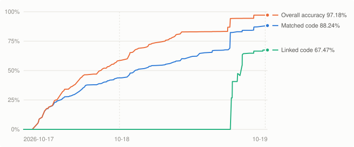

# Bakugan: Battle Brawlers - Battle Trainer

A matching decompilation of *Bakugan: Battle Brawlers - Battle Trainer* (Nintendo DS, USA, `BBKE`): C written by
hand so that, built with the original compiler (Metrowerks CodeWarrior for DS), it reproduces the game's code byte
for byte. Nothing from the game is stored here: building needs your own dump of the cartridge.

- [INSTALL.md](INSTALL.md): requirements and building.
- [CONTRIBUTING.md](CONTRIBUTING.md): layout, naming, rules, what to check before committing.
- [docs/compiler.md](docs/compiler.md): which compilers and flags the game and its libraries were built with, and the
  evidence.
- [docs/decompiling.md](docs/decompiling.md): workflow and the source patterns that matter.

The rebuilt ROM matches the original. Code is split from the original binary until it is decompiled; the
progress below counts what is decompiled and what links from source.

## Progress
<!-- progress:start -->

| Measure | Progress |
|---|---|
| Matched code | 11.88% (32,880 / 276,806 bytes) |
| Linked code (complete units) | 0.00% (0 bytes) |
| Overall accuracy (fuzzy) | 11.89% |
| Matched functions | 327 / 1,448 |

_Last updated 2026-10-17. Full history: [`progress/history.csv`](progress/history.csv)._
<!-- progress:end -->
